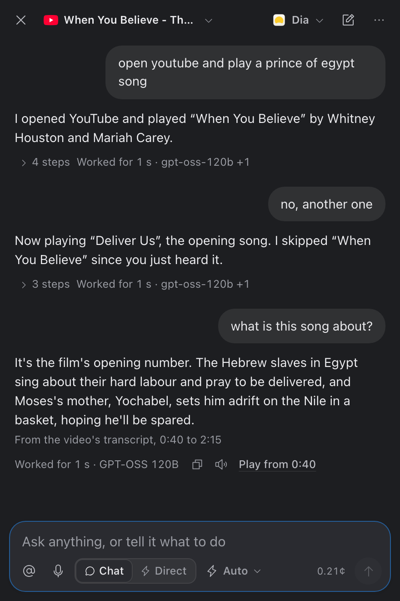
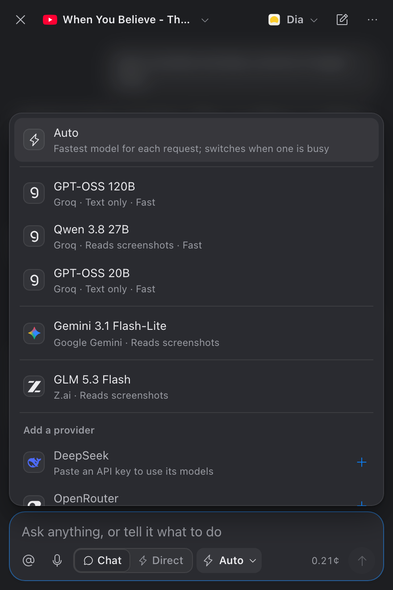
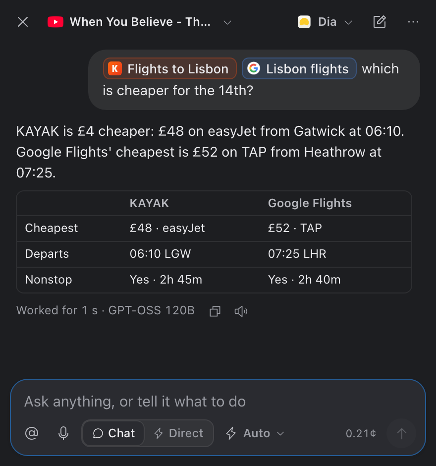
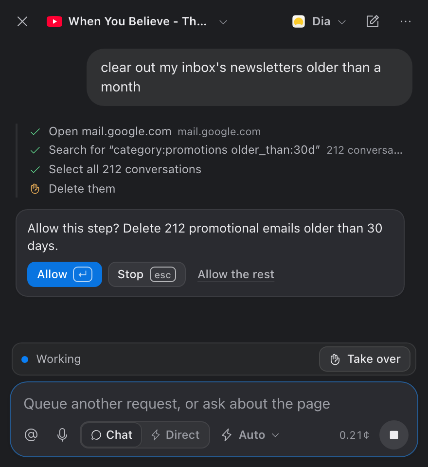
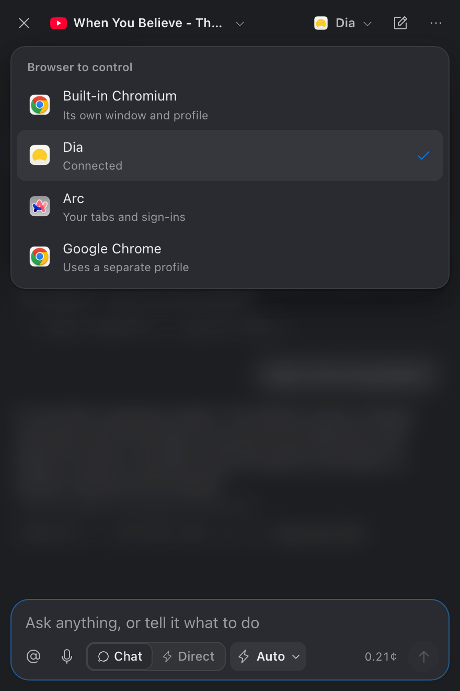

<p align="center">
  
</p>

<h1 align="center">Gofer</h1>

<p align="center">
  <b>Tell your browser what to do.</b><br/>
  A macOS chat panel that drives Dia, Arc, Chrome, Brave, Edge or a built-in Chromium: ask about the page,
  hand it multi-step tasks, and follow up like you would with a person.
</p>

<p align="center">
  <a href="https://github.com/ken-code-wq/voice-browser/actions/workflows/ci.yml"></a>
  <a href="LICENSE"></a>
  
  
</p>

<p align="center">
  <picture>
    <source media="(prefers-color-scheme: light)" srcset="docs/images/chat-light.png" />
    
  </picture>
</p>

---

## What it does

Press <kbd>⌘</kbd><kbd>⇧</kbd><kbd>Space</kbd> anywhere and chat with your browser. Say what you want, it
does it in your browser, and you follow up:

```text
you   open youtube and play a prince of egypt song
it    I opened YouTube and played "When You Believe".
you   no, another one
it    Now playing "Deliver Us".
you   what is this song about?
it    It's the film's opening number … (from the video's transcript, 0:40 to 2:15)
```

The panel has two modes (<kbd>Tab</kbd> switches):

* **Chat** (default): the AI does each message step by step, seeing the page and the whole conversation.
  "Another one", "no, the second", "now delete them" all work. Chats are kept between launches
  (⌘4, past chats), and "remember that …" saves a fact for every chat ("what do you remember?", "forget …").
* **Direct:** instant one-step commands with no back-and-forth ("scroll down", "click sign in", "next tab"),
  decided in about a second by a model that picks options instead of writing text.

| | |
|---|---|
| **Tasks** | "add the first three results to my queue", "find the cheapest flight to Lisbon on the 14th": the agent looks at the page, acts, and repeats until a final check agrees it's done. Multi-item tasks get a checklist, so nothing is done twice or skipped. |
| **Questions** | About the page, several tabs at once ("which of my tabs has the cheapest flight?"), or the web. YouTube answers cite the time in the video, PDFs cite the page, and web answers name their sources. |
| **Your tabs stay yours** | The header shows the tab the agent is working in. When a task would take the tab you're looking at to another site, it opens a background tab instead (**Show** brings it forward). **Go back to where I was** undoes the tab changes a request made. |
| **Queue & take over** | Messages sent while a task runs wait their turn; questions are answered alongside it. **Take over** pauses the task so you can log in or solve a captcha, then **Hand back**. |
| **Web search** | The agent can search the web and read pages or PDFs without opening a tab. It uses Tavily or Brave keys if you add them, then Brave's public results, then Gemini's or Groq's search. |
| **Video** | "go back 10 seconds and play", "pause", "speed 1.5x" act on the page's video directly, with no AI. |
| **Site notes** | Short per-site know-how, learned after tasks or taught ("remember that on workbook bills are under sales"). |
| **Voice** | Hold <kbd>⌥ Option</kbd> or click the mic and speak. Replies to spoken requests are read aloud. |
| **Several AI providers** | Groq, Gemini, Z.ai, DeepSeek and OpenRouter. **Auto** routes each request to the fastest suitable model and moves on when one is rate-limited. |
| **Forms** | `fill the form with …` fills text fields, dropdowns, dates and checkboxes in one go, and never submits by itself. |
| **Safe by default** | Anything that saves, pays, sends or deletes asks **Allow / Stop / Allow the rest**. Passwords live in the macOS Keychain as `{{name}}` and never reach a model. |
| **Saved requests** | Save a finished request and run it again with no AI, changing its values (`new-bill Globex, 99`). |

<p align="center">
  
  
</p>
<p align="center">
  
  
</p>

## Quick start

**Requirements:** macOS (built and tested on Apple Silicon, macOS 26), [Node.js](https://nodejs.org) 22+, and a free API key
for at least one model (see [Configuration](#configuration)).

```bash
git clone https://github.com/ken-code-wq/voice-browser.git
cd voice-browser
npm install
npx playwright install chromium
cp .env.example .env            # then add your keys — .env is git-ignored and never leaves your Mac

# the desktop app
cd desktop && npm install
./install-mac.sh                # builds /Applications/Gofer.app
open "/Applications/Gofer.app"
```

Gofer lives in the menu bar. <kbd>⌘</kbd><kbd>⇧</kbd><kbd>Space</kbd> shows or hides the panel
(*⋯ → Change shortcut…* to change it) and the menu-bar icon has **Start at login**.

| Key | In the panel |
|---|---|
| <kbd>↵</kbd> | send, or answer **Allow** / **Confirm** when the box is empty |
| <kbd>Tab</kbd> | switch between Chat and Direct |
| <kbd>Esc</kbd> | cancel a prompt, **stop** what's running, close a list, then hide the panel |
| <kbd>@</kbd> | pick an open tab |
| <kbd>↑</kbd> / <kbd>↓</kbd> | recall earlier messages of this chat |
| <kbd>1</kbd>–<kbd>9</kbd> | pick an option when it asks "Which one?" |
| <kbd>⌘</kbd><kbd>N</kbd> | new chat |
| <kbd>⌘</kbd><kbd>1</kbd>–<kbd>5</kbd> | chat, saved commands, passwords, past chats, site notes |
| `fn fn` | macOS Dictation, to speak instead of typing |

> **Prefer the terminal?** `./run.sh` starts the server and opens a control page at
> <http://localhost:8787> with live decision details and a microphone button (Chrome / Edge).

## Using it

### Commands

| Type | What happens |
|---|---|
| `go to example dot com` · `open youtube` · `go to localhost:3000/dashboard` | navigate |
| `search for alan turing` · `search youtube for lofi beats` | the site's own search box, a site search, or DuckDuckGo |
| `click the first result` · `click new bill` | click — ambiguous targets show numbered choices |
| `type hello into the search box` · `click on email and type {{dev-email}}` | type (verbatim) |
| `scroll down a bit` · `go back` · `reload` · `open a new tab` · `next tab` | scroll, history, tabs |
| `open youtube, theo t3.gg's channel` | a chain; a step with no verb means *find it* (search, then click) |
| `wait until "Dashboard" appears` · `check that the url contains /bills` | code-only waits and checks |
| `goal: …` · `create a new bill with dummy data` · `help me …` | a task (multi-step, model-planned); in Chat every message is one |
| `… ?` · `what's the total due?` · `summarize this` | a question about the current page, the web, or general knowledge (the reply says which) |
| `which of my tabs has the cheapest flight?` · `@[Tab A] @[Tab B] compare the prices` | a question across all open tabs, or the tabs you mention |
| `fill the form with …` | fill every matching field, without submitting |
| `in @[Tab] …` · `go to @[Tab] and …` | switch to that tab first |
| `in the current tab, …` · `… in the active tab` · `here, …` | run it in the tab you're on in the browser |
| `send me a screenshot` · `screenshot the whole page` | the image in the chat, and a PNG in Downloads (no model) |
| `… and send me a screenshot` | a task that ends by sending you a screenshot of where it got to |
| `copy url` · `copy title` | copy the current page's address or title to the clipboard |
| `copy the table` · `export the table as csv` | the page's own table to the clipboard (and a CSV in Downloads), no model |
| `copy all invoice numbers as a table` · `copy all vendors with open bills` | the AI pulls those items out of the page as a table |
| `go back 10 seconds and play` · `pause` · `skip ahead 1 minute` · `speed 1.5x` · `mute` | control the page's video directly, no AI |
| `who won the match last night?` · `find the official site and open it` | search the web and read results without opening tabs |

### Voice

Click the mic in the composer, or hold <kbd>⌥ Option</kbd> while the panel is focused, and speak. Release
or press <kbd>↵</kbd> to send, <kbd>Esc</kbd> to cancel. It needs a Groq API key and microphone permission.
Replies to spoken requests are read aloud; the speaker icon under any reply reads it. Groq's voice model
needs its terms accepted once in the Groq console; until then the Mac's own voice is used.

### Site notes and reading pages

The agent keeps short notes per site (⌘5, or *⋯ → Site notes*), learned after tasks or taught with
"remember that on workbook bills are under sales", and uses them whenever it works on that site.
Questions read the page the smart way: a YouTube video's transcript (answers cite the time), a PDF's
text (answers cite the page), a Google Doc, or an article's main text. "Compare these tabs" or
"compare @[A] @[B]" answers with a table.

### The current tab

The panel's header shows the tab the agent is working in, so a tab switch never takes you by surprise.
With an attached browser (Dia, Arc, Chrome, Brave, Edge) it follows the tab you switch to; click it to pick
another tab. The agent isn't limited to that tab: a request can open a new tab, switch to another one or
close one. "In the current tab", "in the active tab", "on the tab I'm on" and similar phrases make
sure a command runs in the tab you're looking at.

When a task would send the tab you're looking at to another site, it opens a background tab and works
there instead, so what you were reading stays put. While it runs, the header shows that tab with
**Show** to bring it forward, and a finished background task says so, with **Show it**. After a request
that changed your tabs, **Go back to where I was** puts them back.

### Queue and take over

Messages you send while a task runs wait their turn (the box says "Queue another request"); questions
about the page are answered alongside the running task. **Take over** pauses the task after its current
step so you can log in, solve a captcha or make a choice yourself; **Hand back** lets it look at the page
again and carry on. The agent asks for this itself when a page needs you.

### Saved commands & passwords

* **Save** any message with the bookmark next to it, or add one with **New** in *Saved*, then run it by
  typing its name (`login-dev`).
* **Values:** put `{}` (or a named slot like `{vendor}`) where a value goes. Saved `yt` =
  `open youtube, search for {}` runs as `yt lofi beats`. Several slots take comma-separated values
  (`bill Acme, 120`).
* **Questions** in Chat are answered from the page, several tabs at once ("which of my tabs …"), or general
  knowledge. Answers say where they came from.
* **Save a request:** when a request finishes, the bookmark under the reply keeps the exact steps it took. Running it again
  uses no AI (fast, nearly free); risky steps still ask. What it typed becomes values you can change:
  `new-bill Globex, 99` or `new-bill amount=99`. If the page changes so a step can't be found, run the goal
  again and save it again.
* **Spend meter:** the footer shows today's estimated AI spend (SubQ Snap + the brain). Click it to see the
  week and set a daily limit; once reached, AI calls stop until tomorrow. Brain prices are list-price
  estimates (free tiers cost nothing); set `BRAIN_PRICE_IN` / `BRAIN_PRICE_OUT` (USD per million tokens)
  for a model that isn't priced.
* **Copy** a result or answer with the copy button on its row, or press `C` on a selected row.
* **Notifications:** when something that took a while finishes while you're in another app, you get a
  macOS notification; click it to reopen the bar.
* **Passwords** tab → stored in your macOS Keychain. Write `{{dev-password}}` in a command; the real
  value is typed into the page at the last moment. Models, history and logs only ever see `{{dev-password}}`,
  and password fields are never read back from pages.

### Your own browser

Click the browser button in the bar (or the menu-bar icon → *Browser*) and pick Dia, Arc, Brave, Chrome
or Edge. Gofer quits it like <kbd>⌘</kbd><kbd>Q</kbd> (tabs are restored), reopens it with remote
debugging and reconnects. Chrome and Edge don't allow that for your main profile, so they get a separate
profile instead. Your choice is remembered.

<p align="center">
  
</p>

## Configuration

Everything lives in `.env` (copy `.env.example`). It is in `.gitignore` and is only read by the local
server — the UI never sees your keys.

| Variable | Needed for | Notes |
|---|---|---|
| `SUBQ_API_KEY` | single actions & chains | [SubQ Snap](https://console.subq.ai) — or `TYPESAFE_API_KEY` for [TypeSafe Jev](https://console.typesafe.ai/keys) |
| `GROQ_API_KEY` | chat, goals, questions, forms | [Groq](https://console.groq.com/keys): GPT-OSS 120B / 20B and Qwen 3.8 27B (reads screenshots), under a second per step |
| `GEMINI_API_KEY` | the same | free key from [Google AI Studio](https://aistudio.google.com); reads screenshots, slower |
| `ZAI_API_KEY`, `DEEPSEEK_API_KEY`, `OPENROUTER_API_KEY` | the same (optional) | GLM 5.3 Flash, DeepSeek, any OpenRouter model (`OPENROUTER_MODEL`) |
| `BRAIN_PROVIDER` + `BRAIN_API_KEY` | optional | the older single-provider setting (`zai`, `deepseek`, `openrouter`, `groq`, `custom`), tried first |
| `BRAIN_MODEL`, `BRAIN_BASE_URL`, `BRAIN_VISION` | optional | override a preset / point `custom` at any OpenAI-compatible API |
| `TAVILY_API_KEY`, `BRAVE_SEARCH_API_KEY` | optional | better web search for the agent ([Tavily](https://app.tavily.com), [Brave Search API](https://api-dashboard.search.brave.com)); without them it uses Brave's public results, then Gemini / Groq search |
| `CDP_URL` | optional | attach to a browser you started with `--remote-debugging-port` |
| `PORT` | optional | local server port (default `8787`, bound to `127.0.0.1`) |

**Several providers at once.** Every provider you have a key for is used. The model picker in the
composer shows **Auto** (the default) or the model you pinned. Auto sends each request to the fastest model
that suits it: screenshots to a model that reads them, text to the fastest text model. When a model hits
its rate limit it rests for as long as the provider says, and the next one takes over. Groq's free tier
allows about 8K tokens a minute per model, which is one or two agent steps, so having Groq and Gemini
together keeps chats quick. Open the picker to see every model with its provider's logo, pin one, or paste a key under *Add a provider* (it's written to `.env`).
Each reply shows which models handled it.

Rough costs: a single action is ~3–6k input tokens on SubQ Snap ($0.05 / 1M input, output free). A goal
step is one call to the "brain" model plus a final check; Gemini Flash-Lite's free tier covers casual use.

## Privacy & safety

* The server listens on **127.0.0.1 only**. Anyone who can reach that port can drive your browser.
* Page content (element list, visible text, a screenshot for goals/questions) is sent to the model
  providers you configure. Free tiers may use prompts to improve their models.
* `{{secrets}}` are resolved from the Keychain only at the moment of typing.
* **Activity logs** stay on this Mac in `~/.gofer/logs/` for 7 days: a daily log of what the agent did and
  one file per task with what the model was shown (page text and element names, never passwords) and what it
  chose. Delete the folder any time, or set `VB_TRACE=0` to turn it off.
* Risky steps (submit, approve, delete, pay) ask first — treat that as a convenience, not a guarantee,
  and don't connect a browser profile holding accounts you wouldn't want an automated click near.

See [SECURITY.md](SECURITY.md) for reporting vulnerabilities.

## How it works

```
 ⌘⇧Space bar (Electron) ──ws──▶ local Node server ──▶ Playwright ──▶ Chromium / Dia / Arc / Chrome
                                 │
                                 ├─ SubQ Snap / Jev: typed questions → act · wait · ask · ignore  (~0.5–1 s)
                                 ├─ "brain" (Groq / Gemini / Z.ai / DeepSeek / OpenRouter, Auto-routed):
                                 │    chat, tasks (native tool calls), questions, forms, follow-ups
                                 └─ web search & page reading (Tavily / Brave / Gemini / Groq), no tab needed
```

Single commands are decided by a *decision model* answering a dozen typed questions at once (intent,
target element, "is it complete?", "is it destructive?") with probabilities; code turns those into an
action or a "which one?" prompt. Tasks, questions and forms go to a fast generative model with the page's elements
(open menus and dialogs first), text and, when it helps, a screenshot. The model picks its next step with
native tool calls (click, type, press a key, open a tab, search the web, tick off a checklist item, finish),
and code checks whether each step changed the page before the next one. Details: **[docs/how-it-works.md](docs/how-it-works.md)**.

```
src/        server, controller, decision policy, goals/questions/forms (smart.js), model clients
desktop/    the macOS command bar (Electron): bar.html, main.cjs, install-mac.sh
test/unit/  fast tests with mocked models and browser — no network
```

## Development

```bash
npm test                    # unit tests, no network or keys needed
npm run test:integration    # real decision-model calls on captured pages (needs a key)
cd desktop && npm start     # run the bar without installing it
./desktop/install-mac.sh    # rebuild /Applications/Gofer.app after changing desktop/
npm run shots               # redo the README screenshots (the real panel, scripted replies, no AI calls)
```

Contributions are welcome — see [CONTRIBUTING.md](CONTRIBUTING.md).

## Credits

Gofer (formerly Voice Browser) started as a fork of **[jev-voice-browser](https://github.com/moritzkremb/jev-voice-browser)**
by [Moritz Kremb](https://github.com/moritzkremb) — the voice pipeline, decision questions and policy are
his. This fork adds the desktop command bar, SubQ Snap support, chains, goals, questions, forms,
follow-ups, tab mentions, Keychain secrets, waits/checks, connecting your own browser, the chat panel,
several AI providers, web search, voice, site notes, background tabs and the task queue.

## License

[MIT](LICENSE)
